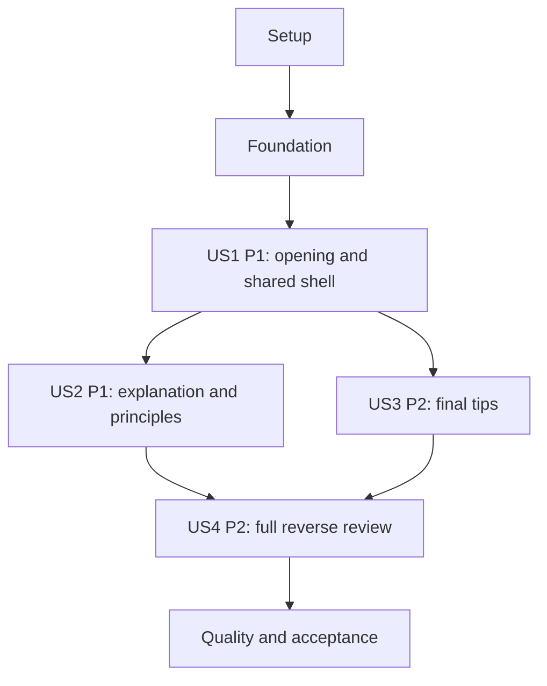

# Tasks: Animated Presentation on Attractive Slide Design

**Input**: Design documents from `specs/001-animated-presentation/`  
**Prerequisites**: [plan.md](plan.md), [spec.md](spec.md), [research.md](research.md), [data-model.md](data-model.md), [contracts/](contracts/), and [quickstart.md](quickstart.md)  
**Branch**: `how-to-create-attractive-presentation-materials`

**Tests**: Required by the constitution, which the specification explicitly incorporates. Every new behavior follows Red-Green-Refactor: write its tests, observe the intended behavioral failure, then implement and refactor while preserving passing tests. Tooling or import failures alone do not count as red evidence. Establish minimal loadable test seams if necessary, without implementing the behavior under test. Already-satisfied behavior needs verification rather than artificial failures or redundant implementation.

**Organization**: Setup and foundation precede four user-story phases in specification priority order. Final tasks cover shared acceptance and quality gates. All tasks are initially unchecked; task generation does not complete implementation work.

## Format: `[ID] [P?] [Story] Description`

- `[P]` identifies tasks in a documented parallel wave, after its prerequisite gate passes. Parallel tasks write different files; it does not permit bypassing TDD or starting dependent work early.
- `[US1]` through `[US4]` map to the four specification stories. Shared phases have no story label.
- File paths are relative to the repository root and name proposed implementation outputs as well as existing files.
- Each implementation task includes explicit types, no `any`, Google TypeScript style, and documentation for exported/public contracts. Record test commands and red/green evidence in `specs/001-animated-presentation/implementation-evidence.md` at sequential checkpoints.

## Path Conventions

Extend the existing root `app/` application. Feature code lives under `app/how-to-create-attractive-presentation-materials/`; tests use `tests/unit/` and `tests/e2e/`. No database, authentication service, separate frontend/backend application, or external data API is needed. Existing framework and animation versions remain as planned.

## Phase 1: Setup (Shared Infrastructure)

**Purpose**: Make the required tooling runnable and record the implementation comparison base without creating or switching branches.

- [ ] T001 Read `AGENTS.md` and the relevant installed guides in `node_modules/next/dist/docs/` for routing, client boundaries, CSS, testing, and CLI deprecations; record the actual branch, runtime/core versions, and pre-implementation Git SHA in `specs/001-animated-presentation/implementation-evidence.md`, reusing that SHA for coverage comparisons throughout implementation.
- [ ] T002 Install the missing Lucide, Jest/jsdom/React Testing Library, Playwright, Prettier, ESLint compatibility, and TypeScript ESLint packages specified by `specs/001-animated-presentation/quickstart.md`; update `package.json` and `package-lock.json`, retain the installed Next/React/GSAP core versions, and install Chromium/Firefox/WebKit browser binaries.
- [ ] T003 [P] Configure `jest.config.mjs` and `jest.setup.ts` with next/jest, jsdom, the existing alias, Jest DOM matchers, V8 line coverage, and text/JSON-summary/LCOV reports; discover all unit/tooling tests and collect all feature application files even if unimported, including any changed shared application files.
- [ ] T004 [P] Configure `playwright.config.ts` for Chromium, Firefox, and WebKit, production `webServer` at `127.0.0.1:3000`, an explicit preceding build, isolated server ownership, and failure artifacts; make the three specified viewport baselines selectable without suppressing real animation.
- [ ] T005 [P] Configure `.prettierrc.json` and `.prettierignore` for Google-compatible formatting, including two-space indentation, single quotes, and semicolons; ignore dependencies/generated artifacts while keeping authored source and design documentation checked.
- [ ] T006 Register the planned lint/format/typecheck/Jest/coverage/E2E commands in `package.json`, add generated browser artifacts to `.gitignore`, and verify the T003–T005 tools start successfully; record setup results in `specs/001-animated-presentation/implementation-evidence.md` before feature red runs.

**Checkpoint**: Tool execution failures are resolved; browsers and unit tests can run. T003–T005 may run together after T002; T006 waits for all three.

---

## Phase 2: Foundational (Blocking Prerequisites)

**Purpose**: Establish reusable types, scroll geometry, enforceable quality gates, and typed test seams. Complete this phase before any user-story implementation.

- [ ] T007 [P] Write positive/negative fixtures in `tests/unit/lint-rules.test.mjs` for explicit variable/binding/member/parameter/return annotations, forbidden `any`, and public class/interface/function documentation; observe the intended enforcement failures before implementing the local rules, including inferred constants and callback parameters.
- [ ] T008 [P] Write failing coverage-gate tests in `tests/unit/coverage-gate.test.mjs` for an individual executable application file below 80% lines, an unreported/unimported changed file, missing comparison SHA/report, deleted/generated/type-only exclusions, and passing per-file results; aggregate coverage must not conceal failure.
- [ ] T009 [P] Add passing baseline rendering/smoke assertions in `tests/unit/app-shell.test.tsx` for existing `app/page.tsx` and `app/layout.tsx` before scaffold normalization; these protect unchanged rendering and are not claimed as feature red evidence.
- [ ] T010 After T007's red run, implement tested explicit-annotation and public-documentation rules in `eslint/rules/explicit-types.mjs` and `eslint/rules/public-docs.mjs`; integrate them in `eslint.config.mjs` with maintained return-type/no-explicit-any rules, conflicting inference exemptions disabled, and existing Next flat presets retained.
- [ ] T011 After T008's red run, implement `scripts/check-changed-coverage.mjs` to enumerate executable feature and changed shared application files against the recorded base, include untracked new source, reject missing reports, and enforce at least 80% executable lines in each file; verify all coverage-gate fixtures pass.
- [ ] T012 Preserve the T009 rendering assertions while adding required explicit annotations and public documentation to `app/page.tsx`, `app/layout.tsx`, and `next.config.ts`; normalize authored-file formatting required by the global checks and include changed application files in coverage scope without altering their behavior.
- [ ] T013 Define documented readonly entity/runtime interfaces and literal unions in `app/how-to-create-attractive-presentation-materials/_lib/types.ts`: "Use a discriminated union with `id`/`kind`: `title`, `explanation`, `principles`, `tips`."; SceneId is "`title`, `explanation`, `principles`, `tips`"; LayoutMode is "`pinned` or `flow`; reduced motion always uses flow"; MotionPreference is "`normal` or `reduced`"; ScrollDirection is "`forward`, `backward`, or `stationary`"; SceneGeometry has "SceneId, measured start/end scroll positions, entrance/reading/exit intervals; finite ordered numbers"; TimelineLabels has "Ordered finite labels for openingEnd, scene holds, transition ranges, examples-visible range, cue-fade range, final settled state"; ControllerState has "lifecycle, currentTime, targetTime, targetScene, direction, layoutMode, motionPreference, openingComplete"; ViewportAnchor has "SceneId and clamped local reading fraction, used during geometry rebuild"; keep typed GSAP/DOM resource handles separate from content.
- [ ] T014 Write and run failing mapping tests in `tests/unit/scroll-model.test.ts` for pinned normalization, measured flow entrance/reading/exit intervals, fully visible long reading holds, finite ordered geometry validation, overshoot clamping, visibility derivation, and anchor preservation across layout changes; use T013's contracts and no per-frame React state.
- [ ] T015 After T014's red run, implement the tested pure mappings and visibility/anchor rules in `app/how-to-create-attractive-presentation-materials/_lib/scroll-model.ts`: pinned time is `openingEnd + progress × scrollTimelineDuration`, flow uses measured ranges instead of four equal viewport slices, and invalid geometry selects readable fallback behavior.
- [ ] T016 Add explicitly typed geometry/GSAP resource seams and reusable content/DOM fixtures in `tests/helpers/presentation-fixtures.ts` and `tests/helpers/animation-harness.ts` for subsequent controller/component tests; preserve real authored control logic under test, avoid call-list-only assertions, and keep actual GSAP/ScrollTrigger in E2E.
- [ ] T017 Run all foundational tests, lint/format/type checks, and scaffold coverage; verify the tooling catches intended violations and record commands/results in `specs/001-animated-presentation/implementation-evidence.md` before opening user-story work.

**Checkpoint**: All shared gates work, types and geometry are available, and foundational checks pass. T007–T009 form a parallel test wave after Setup; their corresponding implementations wait for red evidence. T013–T015 remain sequential because they share contracts and dependencies.

---

## Phase 3: User Story 1 — Enter the Presentation (Priority: P1) — MVP

**Goal**: Deliver the exact opening content, ordered fade/up entrance, vertical scroll cue, and coherent title exit as an independently reviewable first increment.

**Independent Test**: Visit `/how-to-create-attractive-presentation-materials` at the top. Observe title, presenter/date, then cue; verify two subtle bobs and title fade/up on advancing. Repeat with reduced motion and without successful animation enhancement, without needing later teaching content.

### Tests for User Story 1

- [ ] T018 [P] [US1] Write failing UI/content contract assertions in `tests/unit/content.test.ts` and `tests/unit/presentation.test.tsx` for the route's exact title/presenter/date, immutable four-scene content shape, Japanese landmark language, semantic opening, vertical cue label, and decorative Lucide chevron; use `specs/001-animated-presentation/contracts/presentation-ui.md` as the contract.
- [ ] T019 [P] [US1] Write failing controller contract assertions in `tests/unit/animation-controller.test.ts` for title-before-attribution-before-cue ordering, one finite master/one playhead driver, two-bob loop eligibility, zero-progress initialization guard, interrupted-opening retarget from current pose, readable setup-failure fallback, and normal/reduced modes; use `specs/001-animated-presentation/contracts/animation-controller.md`.
- [ ] T020 [P] [US1] Write failing production-browser opening/early-scroll tests in `tests/e2e/presentation.spec.ts` for exact rendered content, sampled entrance order, smooth initial handoff, cue placement/bobs, title fade/up, native scrolling, and reduced-motion suppression; resolve test-environment failures before recording intended behavior failures.

### Implementation for User Story 1

- [ ] T021 [US1] Create immutable content in `app/how-to-create-attractive-presentation-materials/_lib/content.ts` with metadata constraints "Stable literal `attractive-presentation`", "Literal `/how-to-create-attractive-presentation-materials`", "Exact string from spec, Slide Content", "Literal `Takeshi Masumoto`", "Literal ISO date string `2026-10-03`", and "Literal `ja`"; include a "Readonly ordered four-element tuple" of scenes and a "Readonly two-element tuple" of shared examples, copying every sentence/phrase/tip pair from `specs/001-animated-presentation/spec.md` without generating the date.
- [ ] T022 [P] [US1] Render the semantic title scene and stable future-scene containers in `app/how-to-create-attractive-presentation-materials/_components/slide-scenes.tsx` after T018–T020 red evidence and T021; TitleSlide uses "id, kind, order=1" and "Reads presentation title, presenter, and date", with separate entrance/exit wrappers and a readable unenhanced state.
- [ ] T023 [P] [US1] Implement `app/how-to-create-attractive-presentation-materials/_components/scroll-cue.tsx` after T021/red evidence with label `Scroll`, named Lucide `ChevronDown`, vertical text orientation, decorative icon accessibility, and distinct visibility/bob wrappers so two motion owners never share a transform.
- [ ] T024 [US1] Add the synchronous server shell/static metadata in `app/how-to-create-attractive-presentation-materials/page.tsx` and scoped client/ref ownership in `app/how-to-create-attractive-presentation-materials/_components/presentation.tsx`, composing T022/T023 through the documented typed controller interface and applying `lang="ja"` to the presentation landmark without a data fetch.
- [ ] T025 [P] [US1] Add title/cue typography, presentation colors, Japanese system fonts, safe cue placement, and static-flow fallback styles in `app/how-to-create-attractive-presentation-materials/presentation.module.css` after T024; keep text readable at all three specified viewport baselines without remote font dependencies.
- [ ] T026 [P] [US1] Implement opening/initial title exit in `app/how-to-create-attractive-presentation-materials/_lib/animation-controller.ts` after T024/red evidence using a paused finite master, `tweenTo(openingEnd)`, standalone ScrollTrigger latest-target ownership, initially 0.25-second retargeting, and a separate repeating pair of cue bobs; no automatic scrub competitor, forced snapping, or wheel/touch interception.
- [ ] T027 [US1] Complete initial useGSAP/context-safe lifecycle wiring in `app/how-to-create-attractive-presentation-materials/_components/presentation.tsx` and `app/how-to-create-attractive-presentation-materials/_lib/animation-controller.ts`, including restored nonzero position, immediate reduced-motion flow, partial-setup cleanup, and scoped disposal without global trigger killing.
- [ ] T028 [US1] Run US1 unit/controller/browser assertions and applicable quality/coverage checks, inspect actual opening samples, and record intended red runs plus green results in `specs/001-animated-presentation/implementation-evidence.md`; correct failures before declaring the opening increment complete.

**Checkpoint**: US1 can be demonstrated alone. It is an opening MVP, not completion of the four-slide feature. T018–T020 are a parallel test wave; T022/T023 may run together after their red gate and T021; T025/T026 may run together after T024.

---

## Phase 4: User Story 2 — Understand the Three Core Principles (Priority: P1)

**Goal**: Deliver the explanatory and three-phrase scenes, keeping the same two examples visible and arranged consistently across their transition.

**Independent Test**: Render the explanation/principles group in a component fixture or enter slide 2 in the browser, then advance to slide 3. Verify exact copy, text-before-example entrance, pair identity/arrangement, three phrases only, and persistent cue without replaying the opening.

### Tests for User Story 2

- [ ] T029 [P] [US2] Extend `tests/unit/presentation.test.tsx` and `tests/unit/content.test.ts` with failing UI assertions for the exact explanation heading/two sentences, three separate phrases without extra left copy, one example pair shared by both scenes, meaningful accessible labels, and readable self-contained examples without optional styling.
- [ ] T030 [P] [US2] Extend `tests/unit/animation-controller.test.ts` with failing controller contract assertions for text-before-examples, staggered pair entrance, separate bounded child shake, unchanged outer arrangement through explanation/principles, persistent cue, and shared-pair exit outside its lifetime.
- [ ] T031 [P] [US2] Extend `tests/e2e/presentation.spec.ts` with failing real-motion assertions for two-section desktop layout, sampled explanation-before-pair entrance/rotation, unchanged shared node identity/parent visibility through 2→3, exact principle typography, and narrow sticky-band readability at 390 × 844.

### Implementation for User Story 2

- [ ] T032 [US2] Implement the one mounted pair in `app/how-to-create-attractive-presentation-materials/_components/example-designs.tsx` with quoted constraints "Stable unique identifier, `example-1` or `example-2`", "Meaningful Japanese description of the simplified design", "Local mini-slide content/layout variant demonstrating uncluttered composition", "Small bounded absolute angle selected during visual tuning", and "Distinct stacking order within the overlapping pair"; use local HTML/CSS and separate layout/entrance/shake descendants.
- [ ] T033 [US2] Implement the combined explanation/principles group in `app/how-to-create-attractive-presentation-materials/_components/slide-scenes.tsx`: ExplanationSlide has "id, kind, order=2, heading, paragraphs" and "Exact heading and two prescribed sentences; references the shared example pair"; PrinciplesSlide has "id, kind, order=3, phrases" and a "Readonly three-element tuple in exact order; no additional left-side explanatory copy; references the same pair"; mount T032 once rather than once per scene.
- [ ] T034 [P] [US2] Extend `app/how-to-create-attractive-presentation-materials/presentation.module.css` after T032/T033 for left/right desktop composition, overlapping slightly rotated examples, readable principle spacing, and a flow-mode sticky shared band with reserved space/opaque background that never obscures required text.
- [ ] T035 [P] [US2] Extend the master in `app/how-to-create-attractive-presentation-materials/_lib/animation-controller.ts` after T032/T033/red evidence so explanation text fades/up before pair entrance, the pair persists unchanged through the principles hold, and principles/pair exit upward toward the next scene; isolate child shake and keep it out of the finite master.
- [ ] T036 [US2] Wire stable shared-group/example/text refs in `app/how-to-create-attractive-presentation-materials/_components/presentation.tsx` after T034/T035 without remounting examples on scene changes or rerendering React on animation frames.
- [ ] T037 [US2] Integrate fit-guarded desktop pinning and measured narrow/short-screen flow geometry in `app/how-to-create-attractive-presentation-materials/_lib/scroll-model.ts`, `app/how-to-create-attractive-presentation-materials/_lib/animation-controller.ts`, and `app/how-to-create-attractive-presentation-materials/presentation.module.css`; preserve current reading anchors and keep the pair sticky only within scenes 2/3, adding intended failing cases before any behavior correction.
- [ ] T038 [US2] Run US2 tests plus US1 regressions and applicable quality/coverage checks, confirm local example fallback and no shared-node replacement, and record red/green and viewport evidence in `specs/001-animated-presentation/implementation-evidence.md`.

**Checkpoint**: The central teaching group works independently of opening playback and future tips implementation. T029–T031 are a parallel test wave; T034/T035 may run together after T032/T033 and red evidence.

---

## Phase 5: User Story 3 — Read the Final Six Tips (Priority: P2)

**Goal**: Deliver the final six-card grid, cascading elastic entrance, and cue disappearance, retaining all advice on narrow screens.

**Independent Test**: Enter slide 4 from the existing preceding-scene container, or render its component fixture. Verify exact heading/six pairs, 3 × 2 desktop arrangement, row-major entrance, hidden cue, and reachability of every card at 390 × 844.

### Tests for User Story 3

- [ ] T039 [P] [US3] Extend `tests/unit/presentation.test.tsx` and `tests/unit/content.test.ts` with failing UI assertions for `その他のTips`, exactly six verbatim title/content pairs, unique ordered card identifiers, distinct title/content semantics, and DOM reading order matching the spec's table.
- [ ] T040 [P] [US3] Extend `tests/unit/animation-controller.test.ts` with failing controller contract assertions for row-major stagger, independent outer scene travel versus child scale/fade, final-state cue fade/loop pause, long final reading holds, and reduced-motion cards without zoom/elastic effects.
- [ ] T041 [P] [US3] Extend `tests/e2e/presentation.spec.ts` with failing real-browser assertions for 3 × 2 grids at 1280 × 720 and 1920 × 1080, sampled top-left-to-bottom-right card entrance, rounded/shadowed title/content cards, cue fade-out, and all six reachable cards without horizontal overflow at 390 × 844.

### Implementation for User Story 3

- [ ] T042 [US3] Implement `app/how-to-create-attractive-presentation-materials/_components/tip-card.tsx` using the already-authored data and constraints "Stable unique identifier, `tip-1` through `tip-6`", "Integers 1–6, unique and increasing", "Exact title from the corresponding spec row", and "Exact content from the corresponding spec row"; derive desktop placement/stagger from order rather than a second coordinate list.
- [ ] T043 [US3] Implement the final heading/card list and outer travel wrapper in `app/how-to-create-attractive-presentation-materials/_components/slide-scenes.tsx`: TipsSlide has "id, kind, order=4, heading, cards" and "`その他のTips`, exactly six ordered TipCards", composed from T042 in unchanged DOM reading order.
- [ ] T044 [P] [US3] Extend `app/how-to-create-attractive-presentation-materials/presentation.module.css` after T042/T043 for desktop three-column/two-row cards, rounded corners/subtle shadows/distinct title-content sections, responsive fewer-column flow, and sufficient reading space without clipping the final card.
- [ ] T045 [P] [US3] Extend `app/how-to-create-attractive-presentation-materials/_lib/animation-controller.ts` after T042/T043/red evidence with outer fade/up entrance, sequential child fade/zoom and restrained elastic settling, principles/example exit, cue fade-out, and final fully visible hold; keep the master finite.
- [ ] T046 [US3] Wire typed final-scene/card refs in `app/how-to-create-attractive-presentation-materials/_components/presentation.tsx` after T044/T045, preserving data order and avoiding unnecessary mounts or extra cue instances.
- [ ] T047 [US3] Finish final-scene measured reading holds and reduced-motion/native-flow reachability in `app/how-to-create-attractive-presentation-materials/_lib/scroll-model.ts`, `app/how-to-create-attractive-presentation-materials/_lib/animation-controller.ts`, and `app/how-to-create-attractive-presentation-materials/presentation.module.css`; long tips remain fully revealed through the document end, with no translated/clipped inner card scroller.
- [ ] T048 [US3] Run US3 tests plus existing story regressions and applicable quality/coverage checks, verify both desktop grids and every narrow-screen card, and record red/green, cue, and layout evidence in `specs/001-animated-presentation/implementation-evidence.md`.

**Checkpoint**: The full forward presentation is available. T039–T041 are a parallel test wave; T044/T045 may run together after T042/T043 and red evidence. US3's fixture can use the US1 shell without requiring the US2 text/illustration implementation, although the recommended integration order remains US2 then US3.

---

## Phase 6: User Story 4 — Revisit Earlier Slides (Priority: P2)

**Goal**: Verify and complete reliable reverse navigation, restored decoration/visibility, rapid-input convergence, and repeated round trips across the finished scenes.

**Independent Test**: Start at each of slides 2, 3, and 4 and move to its predecessor. Observe outgoing fade/down and correct restoration, unchanged pair through 3→2, cue return on 4→3, and no drift over twenty complete round trips.

### Tests for User Story 4

- [ ] T049 [P] [US4] Extend `tests/unit/scroll-model.test.ts` and `tests/unit/animation-controller.test.ts` for every backward path, latest-target replacement during opening/entrance/reversal, stale completion suppression, cue/example loop restoration, boundary clamps, media anchor rebuild, failed initialization, idempotent disposal, and development setup/cleanup/setup; record intended failures for missing behaviors while retaining passing tests for already-correct master reversal.
- [ ] T050 [P] [US4] Extend `tests/e2e/presentation.spec.ts` with reverse UI/controller contract checks: sample downward outgoing movement on 4→3, 3→2, 2→1; same example identities/arrangement and continuous visibility on 3→2; restored cue on 4→3; actual browser-restored position; and resize/preference changes without forced title restart.

### Implementation for User Story 4

- [ ] T051 [US4] Complete any failing reverse-path behavior in `app/how-to-create-attractive-presentation-materials/_lib/animation-controller.ts` by traversing the existing bounded master toward lower time, including final outer-wrapper downward exit; preserve current time when replacing the sole playhead driver and do not introduce a separate directional timeline or use `timeline.reversed()` to infer `tweenTo` direction.
- [ ] T052 [US4] Complete cue/example restoration in `app/how-to-create-attractive-presentation-materials/_lib/animation-controller.ts` from current parent visibility: resume eligible child loops returning from tips, keep the same pair unchanged between principles/explanation, and prevent relative transform drift or obsolete driver callbacks.
- [ ] T053 [US4] Complete media/viewport rebuild and scoped lifecycle cleanup in `app/how-to-create-attractive-presentation-materials/_lib/animation-controller.ts` and `app/how-to-create-attractive-presentation-materials/_components/presentation.tsx`, capturing SceneId/local reading fraction, coalescing refresh work, reverting only owned resources, and preventing callbacks from touching disposed content.
- [ ] T054 [US4] Complete any failing non-finite/boundary/rapid-scroll mapping cases in `app/how-to-create-attractive-presentation-materials/_lib/scroll-model.ts`; clamp to first/final valid holds, maintain fully visible reading intervals, and keep transient visible time distinct from the latest requested target.
- [ ] T055 [US4] Run and retain the real-browser reliability suite in `tests/e2e/presentation.spec.ts` across all six adjacent paths and twenty complete down/up round trips, adding fast overshoot/reversal and mid-transition stop/resume cases; inspect node identity, parent visibility, transforms, and settled text without arbitrary sleeps or a production global test controller.
- [ ] T056 [US4] Run US4 unit/controller/browser tests and all earlier story regressions, recording reverse-motion samples, lifecycle/preference/resize outcomes, and applicable quality/coverage results in `specs/001-animated-presentation/implementation-evidence.md`; mark this story complete only after reliable restoration is observed.

**Checkpoint**: All forward/backward scene paths and repeated navigation are verified. T049/T050 may run together after US2/US3 integration; controller corrections T051–T054 remain sequential because they share state/production files.

---

## Phase 7: Polish & Cross-Cutting Concerns

**Purpose**: Complete fallback/accessibility checks, production quality gates, motion evidence, and the specified human acceptance outcomes.

- [ ] T057 Write/run requirement-derived fallback/accessibility tests in `tests/unit/accessibility.test.tsx` and `tests/e2e/accessibility.spec.ts` for readable JavaScript-disabled flow, two local examples without optional styling, Japanese semantic reading order, invisible pinned scenes excluded from hit testing/accessibility, native browser scroll keys, cue non-obstruction, enlarged text, and runtime reduced-motion changes; record red evidence for any uncovered missing behavior before fixes.
- [ ] T058 Fix T057's uncovered fallback/readability/accessibility defects in `app/how-to-create-attractive-presentation-materials/_components/slide-scenes.tsx`, `app/how-to-create-attractive-presentation-materials/_components/example-designs.tsx`, `app/how-to-create-attractive-presentation-materials/_lib/animation-controller.ts`, and `app/how-to-create-attractive-presentation-materials/presentation.module.css`; preserve one shared pair, immediate reduced-motion content, focus stability, and native scrolling.
- [ ] T059 Audit explicit types/no-any/Google style and public JSDoc/TSDoc across feature source, tests, configs, and changed scaffold files; fix remaining violations and document public-contract purpose/parameters/returns/side effects/constraints in `specs/001-animated-presentation/implementation-evidence.md` without weakening enforcement or coverage exclusions.
- [ ] T060 Capture production normal-motion opening/transitions/decorations and review frame traces/video under the specified browser/viewport conditions; store artifact references, environment, sequence results, observed duration/stalled intervals, and the SC-004 calculation in `specs/001-animated-presentation/acceptance/motion-review.md`, requiring at least 95% of observed motion time without a visible stall over 100 ms or discontinuous jump; re-test any tuning fixes through the relevant story tasks.
- [ ] T061 Run the full quality sequence from `specs/001-animated-presentation/quickstart.md`: lint, formatting, typecheck, all Jest tests with coverage, per-file coverage gate against the recorded base, production build, and all Playwright tests; retain per-file executable-line metrics of at least 80%, scope/report paths, and commands/results in `specs/001-animated-presentation/implementation-evidence.md`, fixing failures rather than omitting checks.
- [ ] T062 [P] Conduct the human-assisted ten-first-time-viewer navigation study and record anonymized outcomes/times in `specs/001-animated-presentation/acceptance/navigation-study.md`; SC-002 requires at least nine viewers to reach the final tips and return to an earlier slide within two minutes without coaching beyond the cue, and this task remains unchecked until actual participant evidence exists.
- [ ] T063 [P] Conduct the human-assisted five-viewer readability/animation-comfort review and record both five-point ratings per participant in `specs/001-animated-presentation/acceptance/comfort-study.md`; SC-005 requires at least four viewers to rate both at least 4, and this task remains unchecked until actual participant evidence exists.
- [ ] T064 Reconcile all FR-001–FR-019 and SC-001–SC-007 evidence and the five constitutional principles in `specs/001-animated-presentation/acceptance.md`, update `specs/001-animated-presentation/quickstart.md` with the actual runnable commands/artifact references, and verify all required tasks/gates before reporting feature acceptance; explicitly retain any missing participant evidence as outstanding work instead of inventing results.

**Checkpoint**: Acceptance requires automated, motion-review, and human-study evidence. T062/T063 may run together only after T060/T061 pass on a stable build. If participants are unavailable, complete independent engineering work and leave the relevant study/acceptance tasks unchecked, with the exact missing evidence recorded.

---

## Dependencies & Execution Order

### Phase Dependencies

1. Setup: T001 → T002 → parallel T003/T004/T005 → T006.
2. Foundation: parallel T007/T008/T009; T010 waits for T007, T011 for T008, T012 for T009 and T010. T013 → T014 → T015 → T016; T017 waits for every foundational task and blocks all stories.
3. US1: parallel T018/T019/T020; observe relevant red assertions before production behavior. T021 → parallel T022/T023 → T024 → parallel T025/T026 → T027 → T028.
4. US2: parallel T029/T030/T031 → T032 → T033 → parallel T034/T035 → T036 → T037 → T038.
5. US3: parallel T039/T040/T041 → T042 → T043 → parallel T044/T045 → T046 → T047 → T048.
6. US4: parallel T049/T050 → T051 → T052 → T053 → T054 → T055 → T056.
7. Polish: T057 → T058 → T059 → T060 → T061 → parallel T062/T063 → T064.

Tests and their intended failing assertions gate the corresponding production tasks even when a schema/component task appears earlier in the numerical sequence. If a new defect is found while validating, write/observe its failing behavioral assertion before correcting production code; do not mark a task complete merely because it was attempted.

### User Story Dependencies

US2 and US3 each use the shared US1 route/controller shell but can be tested in their own fixtures; their content assertions do not require replaying US1. US3 can use a predecessor fixture without US2 teaching behavior. The recommended implementation order is US1 → US2 → US3 → US4 to match priority and serialize changes to the shared controller, scenes, stylesheet, and central test files. The diagram shows logical dependencies, not permission to edit these shared files concurrently.

### Within Each User Story

Write UI/controller contract and browser assertions first, observe the intended failures, then implement data/components, controller behavior, ref integration, and visual layout. Run the story's independent scenario and prior regressions at its checkpoint. Each public interface contract is exercised in every applicable story; no HTTP API contract is invented for this UI feature.

### Parallel Opportunities

The `[P]` waves above have disjoint write sets after their gates. Shared evidence files are updated at sequential checkpoints, not by simultaneous workers. US2/US3 production integration is serialized even if isolated test design is delegated separately. Parallel opportunities describe scheduling options; they do not require spawning agents.

## Parallel Example: User Story 1

After T017, prepare T018 (UI/content tests), T019 (controller tests), and T020 (browser tests) in distinct files. After their behavioral red gate and T021, T022 (title scene) and T023 (cue component) can run together. After T024, T025 (CSS) and T026 (controller) can run together; T027 waits for both.

## Parallel Example: User Story 2

After US1, prepare T029 (UI/content), T030 (controller), and T031 (browser) together. After the red gate and T032/T033, T034 changes only the CSS Module while T035 changes only the controller. T036 integration waits for both.

## Parallel Example: User Story 3

Prepare T039 (UI/content), T040 (controller), and T041 (browser) together within this phase. After the red gate and T042/T043, T044 (card CSS) and T045 (final timeline/cue) can run together; T046 waits for both. Do not run these alongside US2's edits to the same files.

## Parallel Example: User Story 4

After both central and final scenes are integrated, T049 edits only unit model/controller tests and T050 edits only the browser suite. Subsequent controller/model/lifecycle corrections are sequential, followed by the reliability run and story checkpoint.

---

## Requirement and Outcome Coverage

| Requirement/outcome | Implementation and validation tasks |
| --- | --- |
| FR-001–FR-003; opening content and order | T013, T018–T028, T039, T043; exact four-scene content in T021 |
| FR-004–FR-005; cue bobs/persistence/end/return | T019–T027, T030, T035, T040–T047, T049–T056 |
| FR-006–FR-007; native forward/reverse transitions | T014–T015, T020, T026–T027, T030–T038, T040–T048, T049–T056 |
| FR-008–FR-011; explanation/principles/shared examples | T029–T038, T049–T056 |
| FR-012–FR-014; six-card content/layout/stagger | T021, T039–T048 |
| FR-015; easing/continuity | T020, T026, T031, T035, T041, T045, T050–T056, T060 |
| FR-016; interruptions/repetition/latest target | T014–T016, T019–T027, T049–T056 |
| FR-017; responsive/reachable content | T015, T025, T031, T034, T037–T038, T041, T044, T047–T048, T053, T057–T058 |
| FR-018; reduced motion | T019–T027, T037, T040–T047, T049–T056, T057–T058 |
| FR-019; self-contained example fallback | T029, T032, T038, T057–T058 |
| SC-001; exact prescribed content | T018, T021, T029, T039, T028, T038, T048, T064 |
| SC-002; first-time task completion | T062, T064 |
| SC-003; six paths/twenty round trips | T049–T056, T061 |
| SC-004; measured motion continuity | T020, T031, T041, T050, T055, T060 |
| SC-005; readability/comfort ratings | T063, T064 |
| SC-006; desktop/narrow baselines | T031, T034, T037–T038, T041, T044, T047–T048, T061 |
| SC-007; complete reduced-motion content/navigation | T019–T027, T040–T047, T049–T056, T057–T058, T061 |
| Constitutional testing/style/types/docs/coverage gates | T001–T017, every story checkpoint, T059–T064 |

## Implementation Strategy

### MVP First (User Story 1)

Complete Setup and Foundation, then US1. Validate its opening scenario and quality checks independently at T028 and use it as a reviewable demo. Later scene containers/data may exist as scaffolding, but the MVP does not satisfy the complete four-slide feature or its final acceptance criteria.

### Incremental Delivery

Add US2's teaching scenes next, then US3's final advice, preserving previous passing tests at every checkpoint. US4 verifies/completes reverse restoration and reliability across the finished deck. Follow with the full automated, motion, and human acceptance gates before reporting the feature complete.

### Parallel Team Strategy

Use only the documented gated waves. Keep one integration owner for shared scenes/controller/CSS files and checkpoint evidence. Contributors may prepare disjoint tests or paired component/style-controller changes after the respective prerequisites; do not infer cross-story parallel edits from the logical dependency diagram.

## Notes

- Total: 64 tasks — Setup 6, Foundation 11, US1 11, US2 10, US3 10, US4 8, Polish 8.
- Exact content is authoritative in `specs/001-animated-presentation/spec.md`; quoted model constraints above are binding, not examples. Use immutable local content and ephemeral runtime state only.
- No feature implementation, test execution, or viewer study is completed by generating this document. T062/T063 require actual human participants; automation cannot supply their evidence.
- Record the original implementation base once, retain failing/passing evidence, and commit logical groups without changing the existing branch. Required final checks cannot be replaced by aggregate coverage or a subset of passing tests.
